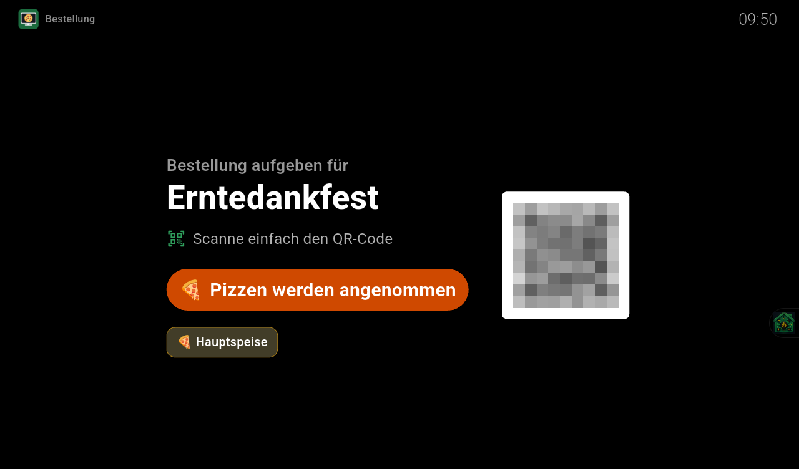
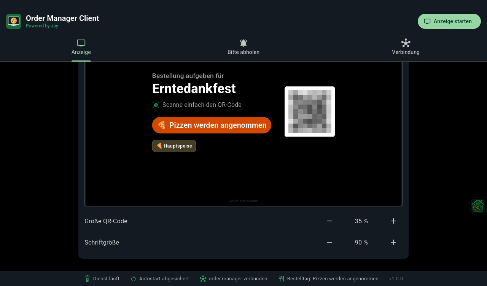
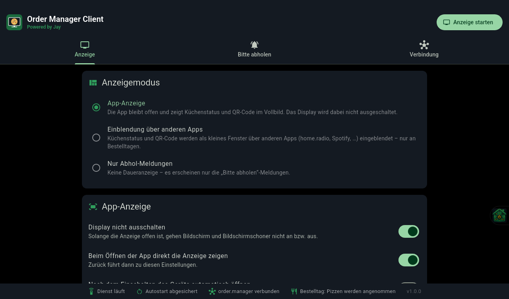

<p align="center">
  
</p>

<h1 align="center">Order Manager Client</h1>

<p align="center">
  <b>Bestell-Anzeige für den <a href="https://github.com/JayLo1401/order.manager">order.manager</a> auf Android TV</b><br>
  Powered by Jay
</p>

Am Bestelltag zeigt die TV-Box den **QR-Code zum Bestellen** und den **Küchenstatus** („🍕 Pizzen werden angenommen“).
Wird eine Bestellung in der Küche fertig, erscheint über allem **„Bitte abholen“** mit Gong. Laufende Musik
(home.radio, Spotify, …) wird dabei nur kurz leiser.

Die App ersetzt die Bestell-Kachel und das „Bitte abholen“-Popup, die bisher in home.radio eingebaut waren.

| Vollbild-Anzeige | Größe einstellen | Einstellungen |
| --- | --- | --- |
|  |  |  |

## Funktionen

### Drei Anzeigemodi

| Modus | Was passiert |
| --- | --- |
| **App-Anzeige** | Die App bleibt offen und zeigt Titel, Küchenstatus, Gänge und einen QR-Code im Vollbild. Das Display geht dabei nicht aus, auch der Bildschirmschoner startet nicht. QR-Code und Schrift lassen sich getrennt verkleinern, damit es auf einem 65"-Fernseher nicht riesig wird. Die Einstellungen zeigen dazu eine maßstabsgetreue Vorschau. Auf Wunsch öffnet sich die Anzeige direkt beim Start der App oder nach dem Einschalten des Geräts. |
| **Einblendung über anderen Apps** | Die App läuft im Hintergrund. An Bestelltagen liegt ein kleines Fenster mit Status und QR-Code über jeder App, zum Beispiel über home.radio oder Spotify. Position (3×3-Raster), Größe, Abstand zum Rand, Deckkraft und Aufbau („breit“ oder „kompakt“) sind einstellbar. Das Fenster lässt sich nicht anklicken und nimmt der App darunter nicht den Fokus. |
| **Nur Abhol-Meldungen** | Keine Daueranzeige, nur „Bitte abholen“. |

### „Bitte abholen“

- Gleiche Gerichte werden zusammengefasst, zum Beispiel *6× 🎃 Kürbiscremesuppe: Anna, Ben, Carla, …*. Jeder Name steht immer da,
  bei vielen Meldungen wird die Schrift kleiner statt etwas abzuschneiden.
- Optionen wie die Eissorte stehen unter dem jeweiligen Namen.
- Gong (Servierglocke „ding! ding!“) mit einstellbarer Lautstärke. Andere Wiedergabe wird über Android-Audio-Ducking
  kurz leiser gestellt und läuft danach normal weiter.
- Anzeigedauer 10–300 s mit Countdown. OK oder Zurück auf der Fernbedienung schließt die Meldung vorher.
- Jede Fertigmeldung erscheint genau einmal. Wird eine Bestellung wieder geöffnet und erneut abgeschlossen,
  erscheint sie noch einmal.

## Voraussetzungen

- Android-TV-Box oder Tablet, Android 7 oder neuer
- ein freigeschaltetes Konto im order.manager (E-Mail und Passwort des Gastgebers)

## Installation

```powershell
./scripts/deploy.ps1 -Release -EnableService -Launch
```

Das Skript baut die APK, installiert sie auf den gewählten adb-Geräten und erteilt die Autostart-Berechtigung.
Mit `-EnableService` schaltet es auch gleich den Hintergrunddienst ein.

Von Hand:

1. APK installieren.
2. In den **Bedienungshilfen** den Dienst **„Order Manager Client“** einschalten.
3. Empfohlen, einmalig am PC:
   `adb shell pm grant at.jaycloud.order.manager.client android.permission.WRITE_SECURE_SETTINGS`
   Damit schaltet sich der Dienst nach Neustart, Update oder „Beenden erzwingen“ selbst wieder ein.

## Einrichten

1. Tab **Verbindung**: Server-Adresse (Standard `https://bestellung.jaycloud.at`), E-Mail und Passwort eintragen,
   dann **Speichern & testen**.
2. Tab **Anzeige**: Modus wählen. Für die Einblendung Position und Größe einstellen, die Skizze zeigt das Ergebnis.
   **Vorschau (15 s)** blendet das Fenster probeweise ein, zum Beispiel über home.radio.
3. Tab **Bitte abholen**: Dauer, Gong und Lautstärke einstellen, dann mit **„Bitte abholen“ testen** ausprobieren.

## So funktioniert es

```
order.manager ──HTTP (Basic Auth)──▶ Hintergrunddienst (Bedienungshilfe)
  /api/v1/today   alle 5 s              └─ Flutter-Engine "overlayMain"
  /api/v1/ready   alle 5 s (am             ├─ Einblendung: Status + QR (kleines Fenster)
                  Bestelltag)              └─ "Bitte abholen" (Vollbild) + Gong mit Ducking
                                     App (Activity)
                                        ├─ Einstellungen
                                        └─ App-Anzeige im Vollbild (Display bleibt an)
```

- Der Hintergrund läuft wie bei **home.control**: Android hält die Bedienungshilfe dauerhaft am Leben. Darin läuft eine
  vorgewärmte Flutter-Engine, die den order.manager abfragt. Angezeigt wird als *Accessibility-Overlay*, deshalb ist
  „Über anderen Apps anzeigen“ nicht nötig.
- Der order.manager kennt keinen Push, deshalb fragt die App ab: `/api/v1/today` im eingestellten Intervall (5–60 s) und
  `/api/v1/ready` nur an einem Bestelltag. Nach einem Fehler wird nach 15 s erneut gefragt, der letzte Stand bleibt so lange stehen.
- Den QR-Code liefert der Server als PNG. Er steht auf einem weißen Feld mit Ruhezone und wird ohne Glättung skaliert.
- Läuft der Dienst nicht, übernimmt die App-Anzeige die Abhol-Meldungen selbst, solange sie offen ist.

## Bekannte Grenzen

- **home.control auf demselben Gerät**: Läutet dessen Türglocke gleichzeitig mit einer Abhol-Meldung, liegen beide
  Meldungen übereinander. Oben liegt die zuletzt erschienene. Beide schließen mit OK oder Zurück.
- Nach „Beenden erzwingen“ ist der Dienst aus, bis die App wieder geöffnet wird. Ohne die adb-Berechtigung muss er dann
  von Hand in den Bedienungshilfen eingeschaltet werden.
- Google Play lässt Bedienungshilfen nur für echte Barrierefreiheit zu. Die App ist deshalb für die eigene Installation gedacht.

## Entwicklung

```powershell
flutter pub get
flutter analyze
flutter build apk --release
./scripts/gen_icons.ps1     # Logo, Icons und TV-Banner neu erzeugen
```

Projektstruktur:

```
lib/
  main.dart                 Einstieg App (main) und Hintergrunddienst (overlayMain)
  core/                     Theme (wie home.control), Einstellungen, Kanal zur Android-Seite
  order/                    API-Client und Abfrage-Logik (Bestelltag, „Bitte abholen“)
  widgets/                  Status-/QR-Karte, „Bitte abholen“-Popup
  display/                  App-Anzeige im Vollbild
  overlay/                  UI der Engine im Hintergrunddienst
  settings/                 Einstellungen
android/app/src/main/kotlin/at/jaycloud/order/manager/client/
  OrderOverlayService.kt    Bedienungshilfe: Engine, Einblendungs-Fenster, OK/Zurück
  Chime.kt                  Gong (synthetisiert) mit Audio-Ducking
  MainActivity.kt           Kanal für die App (Display an, Dienststatus, …)
  BootReceiver.kt, ServiceEnabler.kt, NativePrefs.kt
```

## Lizenz

[PolyForm Noncommercial 1.0.0](LICENSE.md), wie beim order.manager. Private und nicht-kommerzielle Nutzung ist frei,
auch für Vereine, Schulen und gemeinnützige Organisationen. Kommerzielle Nutzung ist nicht erlaubt.
